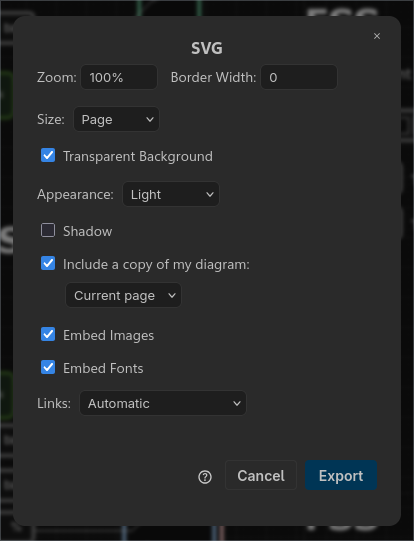

# ASTERIA Mission Control

This repository contains all custom code which runs on the mission control computers,
and interfaces with the [remote computers](http://github.com/aris-space/asteria-remote-computers/) via MavLink.

## Usage

To start a full installation, with frontend, backend and logging, run `just run` or `just run-sudo` if you need tty access for the radio link.

## Backend

The rust code of the backend is directly within the root `src`.

### Usage

The built binary has some bundled CLI flags which can be used to configure the API before starting. Note that most flags can also be set using environment variables.

To get an overview of the available flags, run the binary with the `--help` argument.

### Using Docker

The project contains a `Dockerfile` which builds a full stack version of the ASTERIA mission control. The backend web server is used to serve the statically built frontend.

To start the current development version of the mission control inside docker, you can simply run:

```bash
# Build new docker image and start it.
# If you also want to have a local flight computer, start with the `--profile full`
# flag instead.
docker compose --profile mission-control up
```

after that you should be able to open the mission control UI on [http://localhost:8888](http://localhost:8888).

### Internal Documentation

The API is documented using [OpenAPI](https://www.openapis.org/). An interactive playground of the API is available under the `/docs/ui` path and the OpenAPI schema can be found under the `/docs/openapi.json` path.

In general, all API endpoints except the ones used for documentation are prefixed with `/api/` to allow serving the static UI from the API directly using [actix-files](https://crates.io/crates/actix-files).

### Config

The backend needs a config file. The path of the config file can be specified as a CLI flag or through the `CONFIG_PATH` environment variable (see [usage](#usage)).

Besides a few other things, the config mainly contains a list of available remote computers to which the mission control can connect to.

The config is written in TOML and follows the schema hosted by the backend on the `/api/config/schema` path.

## UI

The code for the mission control UI is located in [the ui subdirectory](./ui/)

### Diagrams

For the state machine and PSS views we use [draw.io](https://www.drawio.com) diagrams exported as SVG.
There are some things which need to be followed whilst exporting the diagram as a SVG such that the SVGs can successfully be used by the mission control:

- The SVG background needs to be set to **transparent**
- The SVG appearance needs to be set to **light**
- The "Include a copy of my diagram" option needs to be **enabled**. For multi-page diagrams, only include the current page of the diagram.
- **Don't export from a selection**, always select **document** as size (or **page** when exporting from a multi-page diagram)
- The [**svgdata** plugin](https://www.drawio.com/doc/faq/plugins) needs to be enabled, this can either be done by having the `?p=svgdata` URL query parameter or by explicitly adding the plugin inside your editor

> [!IMPORTANT]
> The draw.io plugins are not stored inside the diagram file. They need to be enabled on every editor with which you want to edit the diagram!

<p align="center">
  
</p>

### Validating state machine configs

To check that all state machine TOML configs in the `remote-computers` submodule match their referenced
diagrams (states, actuators, etc.), run:

```bash
cargo test --package asteria-mission-control all_state_machine_configs_match_their_diagram -- --nocapture
```

## Logging

The mission control logs in 3 ways: warnings to stdout, mavlink messages to a **jsonl** file and additionally to a **InfluxDB**

### Setting Up the Environment

- Create a new file named `.env` in the repository directory.
- Add the following environment variables to the `.env` file:

  ```sh
  INFLUXDB_USERNAME=Admin
  INFLUXDB_PASSWORD=<your_secure_password> # Choose a password for your local InfluxDB database and Grafana; must be between 8 and 72 characters long
  INFLUXDB_TOKEN_LOCAL=<your_local_influxdb_token> # Choose any token you prefer
  ```

### Startup

Start the logging with `docker compose --profile logging up`, and shut down again with `docker compose down`.

### Access InfluxDB database and Grafana UI

- the local InfluxDB database can be reached [here](http://localhost:8086)
  - Username: Admin
  - Password: defined in your `.env` file
- the local Grafana instance can be reached [here](http://localhost:3001)
  - Username: Admin
  - Password: defined in your `.env` file (same as for local InfluxDB)

### Offline tile server

Since the Mission Control is also expected to work in environment without internet, there is the ability to download offline maps and use a local
tile server instead of the hosted OpenStreetMaps tiles.

First, the `tiles.Dockerfile` is used to create a new tile server. When you want to add a new region to this tile server, look up the bounding box
of your region on [https://bboxfinder.com](https://bboxfinder.com) and use this bounding box to add a section like this in the `extractor` phase of the build:

```bash
# Get coordinates from <https://bboxfinder.com>.
ENV BBOX_DUEBENDORF="8.617401,47.389285,8.677826,47.409619"

# Download the tiles for this region into `duebendorf.pmtiles` which will then
# be served under `/duebendorf.pmtiles`.
RUN --mount=type=bind,from=pmtiles,source=/go-pmtiles,target=/usr/local/bin/pmtiles \
    pmtiles extract \
      https://build.protomaps.com/20250324.pmtiles \
      duebendorf.pmtiles \
      --bbox="$BBOX_DUEBENDORF"
```

Once added to the tile server, the new region needs to be added as a tile server to the config.
Because the downloaded tiles are vector tiles, you'll also need to specify a fonts and sprites URL.
The tile server container created using `tiles.Dockerfile` serves the fonts and sprites from the `tiles` directory
from the project root, so you'll want to use those:

```toml
# Unique name of your tile server.
[tiles.duebendorf]
# Description of the tile server which is shown on the frontend.
description = "Dübendorf (Docker)"
# The downloaded tiles are vector tiles.
type = "vector"
# The url to the vector tiles.
url = "http://localhost:8877/duebendorf.pmtiles"
# The url to the fonts.
fonts = "http://localhost:8877/fonts"
# The url to the sprites.
sprites = "http://localhost:8877/sprites"
```

The `docker-compose.yml` in the project root contains a fully configured tile server which is exposed under [http://localhost:8888/](http://localhost:8888/).
By running `docker compose --profile tiles up -d`, the tile server will be started.
Alternatively, `--profile full` will also start the tile server in addition to everything else.

## Development Utilities

### Local flight computer setup

The `fc.Dockerfile` can be used to build a docker image containing a built version of the flight computer contained in the remote-computers submodule.

The image also contains a mavlink-router which automatically gets started and which expects a config to be mounted at `/etc/mavlink-router/main.conf`.
Additionally, there is also a SSH server running inside the container at port `22` (needs to be mapped to non-standard host port, e.g. `2222`) which allows passwordless root logins.
This means, `ssh -p 2222 root@localhost` connects into the container.

The `docker-compose.yml` in the project root contains a fully configured setup for such a flight computer. By running `docker compose --profile flight-computer up -d`, there will be a MavLink TCP server at port `5766` to which the local mission control can connect. Also, the SSH server is mapped to port `2222`.

If you want to test a full deployment of the mission control and a flight computer, run `docker compose --profile full up -d`.
A statically compiled version of the mission control is then available under [http://localhost:8888](http://localhost:8888) which is connected to the flight computer running inside the docker container.

### Replay MavLink messages from a log file

The `mavlink-log-replay` crate contains the logic for replaying logged MavLink messages from the Mission Control backend.

A docker image for the replay can be built using the `replay.Dockerfile` in the project root.
Similarly to the flight computer docker image, it also contains a mavlink-router which expects a config to be mounted at `/etc/mavlink-router/main.conf`.

MavLink logs which are worth replaying are stored in the `replays` directory.

> [!IMPORTANT]
> Please don't check in full MavLink log JSONL files. Ideally, the files stored (and tracked) in the `replays` directory
> only contain some relevant subsequence of a MavLink log file.

The `docker-compose.yml` in the project root contains a fully configured setup for such a replay "remote computer". By running `docker compose --profile replay up -d`, there will be a MavLink TCP server at port `5776` to which the local mission control can connect.
If you also want to start the local flight-computer as part of the docker compose, the `remote-computers` or `full` (`full` also starts a mission control in a container) profile can be used.
